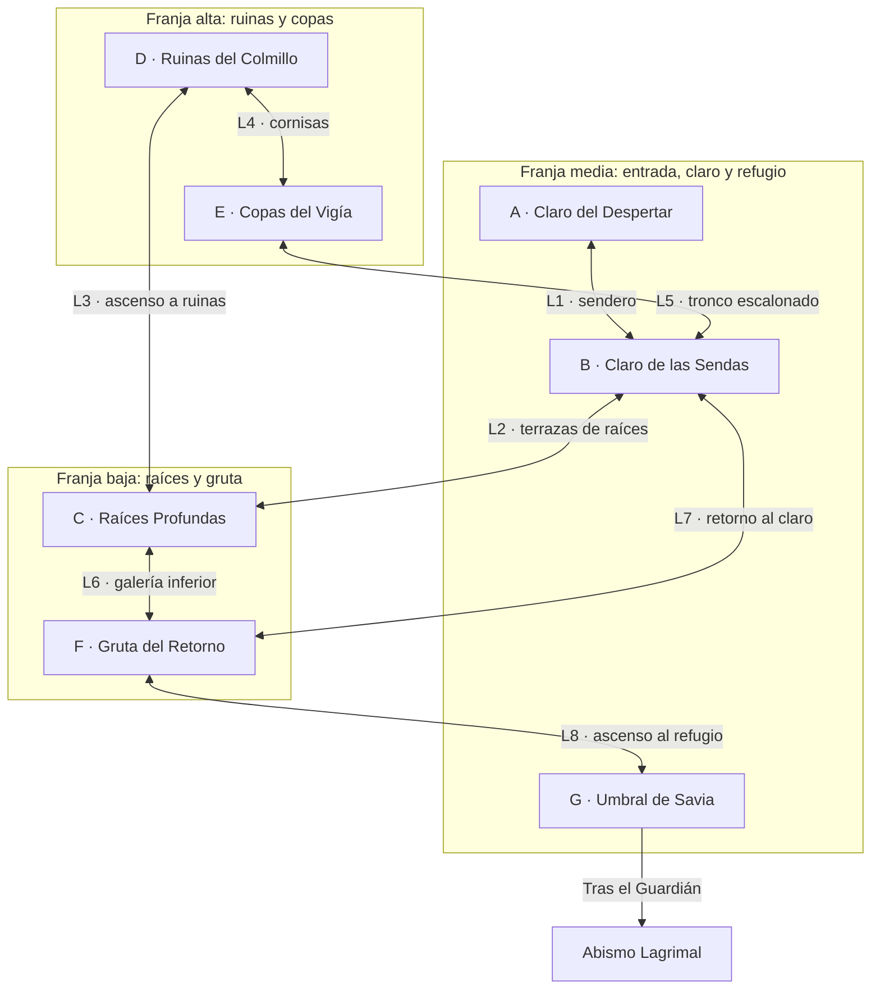

# Arboleda Verdescente — Plano estructural T16

## 1. Estado y decisiones

**Documento histórico de propuesta T16, con referencias de seguimiento hasta T24.** T16 planificó la región sin construir salas ni modificar `ArboledaPrototype`. Los nombres de áreas y salas son de trabajo. Los identificadores A–G y L1–L8 permiten revisar las conexiones sin depender de esos nombres.

**Estado técnico actualizado en T22:** el usuario confirma T01–T21 aprobadas. T22 adapta la geografía inicial de A↔B↔C; se mantienen los seis enlaces bidireccionales del circuito. E↔B y G siguen sin implementar. Las secciones 11–15 conservan el historial de propuestas T16–T21; la sección 16 registra lo construido en T22.

**Referencia espacial:** [Region1SpatialMap.md](Region1SpatialMap.md) y su [plano de bloques](Region1SpatialMap.svg) concretan la planta T21 aprobada como base provisional. Solo P01 y P04 recibieron adaptación física parcial en T22. Las franjas, conexiones y atajos de T16/T20 se conservan aquí como antecedentes; el SVG no representa todavía todas las escenas construidas.

**Seguimiento regional T23:** [Region1DevelopmentRoadmap.md](Region1DevelopmentRoadmap.md) organiza geografía/exploración, enemigos/contenido, progresión/mapa/jefe y arte/ambientación. El encargo confirma T01–T22 aprobadas manualmente; T23 queda pendiente de revisión. La hoja distingue las seis escenas técnicas de las 16 salas objetivo, conserva pendientes P17 y las adquisiciones, y registra por separado la propuesta de sala 17 del jefe, cuya relación con la arena G2 debe resolverse sin duplicar contenido. T24 iniciará la Fase 1; las tareas posteriores y su numeración son provisionales. No se modifican aquí el GDD, la planta espacial ni los assets.

**Actualización T24:** el usuario confirma T01–T23 aprobadas. Se reutiliza la escena B como B1 de 16 unidades, con RoomId B/checkpoint conservados; se añade B2 Pasarela Quebrada como escena y definición propias, conectada por P02 a cota global (16,0). El lado este del pozo B termina ahora en x=14 para una llegada segura, manteniendo el eje P04 x=11. El acceso técnico F se recoloca elevado y separado de P02, conserva IDs y sigue geográficamente provisional. B3 no existe y P03 queda cerrado sin puerta falsa. Dimensiones, recorridos, posiciones vigentes y límites figuran en [Region1SpatialMap.md](Region1SpatialMap.md), sección 18. T24 queda pendiente de aprobación manual; GDD, SVG y las otras escenas existentes no se modifican.

| Estado | Decisión |
| --- | --- |
| Confirmado por GDD e instrucciones | Región compuesta por áreas interconectadas, con exploración horizontal/vertical, circuitos, alternativas, descubrimientos, atajos, dificultad progresiva y descansos estratégicos. |
| Confirmado previamente | Alcance de Arboleda: 15–18 salas, objetivo inicial 16. Un **área** agrupa varias salas; una sala es un espacio jugable reconocible, no necesariamente un asset `.unity`. |
| Confirmado narrativo | Despertar de la salamandra herida, pasado desconocido, enseñanza opcional del maestro, criaturas huidizas/extrañamente calmadas, marcas de fuerza y cristales lila apagados como pistas del Velo. Guardián Raíz y salida hacia Abismo Lagrimal según GDD. |
| Confirmado funcional | Llamas del Recuerdo como descanso, curación y respawn; identidad blanco-turquesa sobre piedra. Se mantienen las reglas existentes de movimiento y combate. |
| Propuesta T16 | Siete áreas que agrupan las 16 salas anteriores; ocho conexiones base, dos circuitos independientes y posibles atajos adicionales. Distribución ambiental y de encuentros por validar. |
| Pendiente de aprobación | Ubicación/región de los desbloqueos, bloqueos por habilidades, nombres finales, geometría, densidad de encuentros y ubicación/cantidad final de Llamas. |

El plan inicial situaba dash en Raíces Resonantes y doble salto en Copa del Vigía; el GDD también los asignaba a región 1. **T16 deja esas asignaciones pendientes**, conforme a la instrucción actual. Se conservan sus nombres y posibilidades de exploración, pero no se reserva allí una adquisición obligatoria. Las asignaciones históricas no son autorización para implementar desbloqueos.

## 2. Visión y principios espaciales

Arboleda debe sentirse como un mismo bosque visto desde el suelo, sus raíces y sus copas. Un tronco partido reconocible organiza el claro central; las raíces conducen a la gruta y a los cimientos de las ruinas; desde las copas se ven el claro y accesos inferiores que después se pueden recorrer. Se conserva el tono misterioso y melancólico sin explicar el Velo ni inventar historia nueva.

1. **Superponer espacios:** copas sobre el claro, raíces bajo sus caminos y gruta bajo el acceso al refugio. Las áreas comparten huella horizontal; no se colocan siete bloques consecutivos de izquierda a derecha.
2. **Elegir antes de especializarse:** desde el claro se reconoce una subida y una bajada. Las salidas tienen siluetas distintas; los accesos se distribuyen entre sus salas para evitar cuatro puertas iguales en una pantalla.
3. **Volver por otro camino:** cerrar primero circuitos completos. Cada ascenso tiene terrazas de descanso y un retorno reconocible; no añadir ramales largos que solo obliguen a desandar.
4. **Separar ruta base y habilidades futuras:** toda la red base se recorre con dirección y salto normal. Los atajos candidatos pueden quedar inaccesibles en la primera visita sin bloquear el refugio ni el jefe.
5. **Recuperar las caídas:** aterrizar en apoyos o caminos inferiores desde los que se pueda salir con salto normal. Evitar huecos que atrapen al jugador, techos que impidan alcanzar el apoyo siguiente y saltos obligatorios de precisión extrema.
6. **Orientar con lugares:** tronco partido, perfil de ruina, raíces y luz ambiental distinguen los accesos. No se necesita mapa, brújula ni instrucciones textuales obligatorias para seguir el recorrido base.
7. **Alternar ritmo:** exploración, plataformas, descubrimiento, combate y reposo ocupan espacios distintos. Los aterrizajes de una conexión vertical deben permitir observar antes de entrar en combate.

Las franjas siguientes expresan relaciones espaciales, **no coordenadas, alturas de salto ni tamaños de escena**. Cambiar de franja implica una secuencia de apoyos, nunca un único salto gigantesco.

## 3. Siete áreas propuestas

| ID y área | Posición e identidad ambiental | Propósito y progresión | Dificultad aproximada | Conexiones base |
| --- | --- | --- | --- | --- |
| A — Claro del Despertar | Franja media, al oeste del núcleo; vegetación abierta, raíces bajas y luz suave. | Inicio seguro, orientación y presentación de la salamandra herida. Regreso fácil desde el primer cruce. | Baja; movimiento y salto básico sin presión simultánea de combate. | B |
| B — Claro de las Sendas | Núcleo medio, debajo de E; tronco partido visible desde varias alturas, suelo abierto y pasarela rota lateral. | Referencia común, primeras elecciones y retorno de los circuitos. Enseña dónde se puede bajar o subir. Candidato a descanso central. | Baja–media; saltos accesibles y encuentro introductorio separado de las bifurcaciones. | A, C, E, F |
| C — Raíces Profundas | Debajo y algo al oeste de B; contrafuertes de raíces, helechos y terrazas con suelo seguro. | Descubrir la capa inferior y elegir entre ascenso a ruinas o travesía hacia gruta. Introduce cambios de dirección sin habilidades nuevas. | Baja–media; plataformas anchas y recuperación sencilla. | B, D, F |
| D — Ruinas del Colmillo | Franja media-alta occidental, sobre C; piedra cubierta de musgo y fragmentos de columnas. | Descubrimiento ambiental y primera memoria opcional del maestro; paso alternativo hacia las copas. La memoria no es una llave. | Media; exploración pausada y ascenso moderado. | C, E |
| E — Copas del Vigía | Franja alta, sobre B y parte de F; ramas escalonadas, claros entre hojas y mirador. | Perspectiva de lugares conocidos, plataformas opcionales más exigentes y retorno al claro. Se puede llegar desde B o D. | Media–alta opcional; salto normal con margen, descansos y caída recuperable hacia B/C. | D, B |
| F — Gruta del Retorno | Debajo del lado oriental de B y del acceso a G; piedra húmeda, raíces largas y luz tenue, sin objetos turquesas decorativos. | Travesía inferior propia, ascenso de retorno al claro y acceso al refugio. Reconecta exploración con preparación del combate final. | Media; alterna navegación tranquila y encuentro de preparación en suelo estable. | C, B, G |
| G — Umbral de Savia | Franja media oriental, cerca de F; refugio despejado, transición a arena y salida regional. | Descanso antes del Guardián Raíz, encuentro previsto por GDD y cierre hacia Abismo Lagrimal. Mantener legible el regreso al refugio. | Acceso bajo–medio; combate del jefe según GDD, sin redefinir sus reglas. | F; salida tras el Guardián |

### Reagrupación de las 16 salas anteriores

Se preservan los nombres y funciones compatibles del plan inicial. Cambian la topología y las asignaciones de desbloqueos. Esta distribución es una hipótesis de trabajo que suma 16 salas, no contenido ya construido.

| Área | Salas del plan anterior | Función conservada o ajuste |
| --- | --- | --- |
| A | 1 Claro del Despertar | Inicio y presentación ambiental. |
| B | 2 Sendero de Esporas; 3 Pasarela Quebrada; 7 Tronco Partido | Orientación, referencia central y vista de una conexión futura. La pasarela rota no bloquea el acceso normal a las copas. |
| C | 4 Hondonada de Helechos; 6 Raíces Resonantes | Exploración segura inferior y ascenso; se retira la adquisición obligatoria de dash. |
| D | 5 Santuario del Colmillo; 8 Galería de Musgo | Memoria opcional y pistas ambientales ya previstas; la galería se conecta al recorrido de ruinas, sin exigir un secreto obligatorio. |
| E | 9 Nido Suspendido; 10 Cámara del Polen Quieto; 11 Copa del Vigía | Plataformas, calma extraña y mirador; se retira la adquisición obligatoria de doble salto. |
| F | 12 Atajo de las Raíces; 13 Umbral del Guardián | Retorno al centro y preparación del tramo final. El escondite por habilidad se conserva solo como posibilidad pendiente. |
| G | 14 Refugio de Savia; 15 Cámara del Guardián Raíz; 16 Salida del Velo | Descanso, jefe y cierre regional. |

No se decide aquí cuántas escenas Unity alojarán estas salas ni cómo se cargarán. Las conexiones entre salas de una misma área se detallarán al construir cada bloque, respetando los puertos del plano regional.

## 4. Diagrama de conexiones base

Todos los enlaces de doble flecha son **bidireccionales con salto normal**, sin necesidad de adquirir una habilidad o activar un mecanismo. La flecha hacia Abismo representa el cierre posterior al Guardián del plan anterior; su implementación se decidirá en la tarea correspondiente. Los atajos por habilidades de la sección 7 no forman parte de este diagrama base.

Es un plano de relaciones, no una planta a escala. La tabla espacial y los puertos siguientes gobiernan la futura colocación; el renderizador de Mermaid puede distribuir los nodos de otra forma.

| Enlace | Puertos y dirección espacial | Qué permite reconocer |
| --- | --- | --- |
| L1 A ↔ B | Sendero bajo hacia la base del tronco; regreso sin caída irreversible. | El claro permanece visible antes de entrar y al regresar al inicio. |
| L2 B ↔ C | Abertura occidental del claro, con terrazas que bajan entre raíces. | Desde B se ve el primer aterrizaje; desde C se reconocen la raíz y la luz del claro. |
| L3 C ↔ D | Ascenso por cimientos y terrazas, con pequeños cambios de dirección. | Perfil de las columnas antes de alcanzar la ruina; raíces conocidas vistas desde sus cimientos. |
| L4 D ↔ E | Cornisas laterales que suben gradualmente hacia las ramas. | Mirador visible desde la ruina y columnas reconocibles desde las copas. |
| L5 E ↔ B | Zigzag normal por el tronco, separado de la futura pasarela directa. | Copa y base del mismo tronco como referencia común, con apoyos visibles al bajar. |
| L6 C ↔ F | Travesía inferior con desniveles y descansos, bajo el claro. | Cambio gradual de raíces a piedra húmeda; se anticipa el ascenso oriental. |
| L7 F ↔ B | Ascenso por la cara oriental del tronco hacia otra sala del claro. | Reaparición junto a un lugar conocido desde una altura distinta; conexión alternativa al camino por C. |
| L8 F ↔ G | Ascenso ancho y descansado hasta el refugio, antes de la arena. | Llama reconocible y suelo protegido antes de entrar al combate; retorno a F accesible desde el refugio. |

## 5. Progresión inicial y circuitos

La red completa A–G debe poder navegarse sin dash, doble salto, pogo o parry. Esto se refiere a **acceso y plataformas**; no sustituye las reglas de combate del jefe por un requisito de salto normal.

- **Primer recorrido sugerido, sin imponer orden:** A → B → C → F → G. Presenta el claro desde arriba, explora sus raíces y vuelve a subir cerca del refugio. El jugador puede investigar D/E antes o después.
- **Alternativa superior:** A → B → E → D → C → F → G. El ascenso por L5 ofrece mayor exigencia de plataformas; la ruta por C permite evitarlo. Visitar D no obliga a activar ni obtener la memoria.
- **Regreso corto por conocimiento:** A → B → F → G también es válido si se descubre L7 desde B. No se introduce una cerradura para impedirlo: la libertad de ruta es deliberada. Si en prueba humana vacía de interés el resto de la región, revisar disposición y ritmo antes de proponer un bloqueo nuevo.
- **Circuito superior, cuatro áreas:** B → C → D → E → B. Une descenso, ascenso por ruinas, mirador y regreso por el tronco; también se recorre al revés.
- **Circuito inferior, tres áreas:** B → C → F → B. Permite bajar por un acceso, avanzar bajo el claro y volver por el otro. L7 evita repetir la exploración de C cuando se vuelve desde F.

Los dos circuitos comparten B–C, pero sus retornos son diferentes: D–E–B y F–B. Son dos ciclos independientes de una red de siete áreas y ocho enlaces base. A es una entrada segura y G un cierre; no hace falta convertir inicio o arena en otro bucle.

### Atajos, observación y regreso

- **L7 es un atajo de recorrido siempre abierto**, no un desbloqueo. Encontrarlo cambia el conocimiento del espacio, no el estado de una puerta. Sus dos entradas deben ser visibles al aproximarse; no esconder deliberadamente la salida de la gruta.
- Desde B se observa parte de E antes de llegar; L5 da un camino normal más largo, mientras una separación lateral puede anticipar una futura conexión directa. No insinuar que un salto imposible forma parte del camino base.
- Desde F se ven raíces y una abertura superior hacia E; el camino normal de regreso pasa por B. En D, una ventana hacia F puede anticipar un paso lateral futuro sin exigir recordarlo para continuar.
- Desde el refugio se reconoce el retorno a F y luego al claro. Al regresar, el tronco partido permite orientarse sin memorizar una lista de puertas.

## 6. Capacidades y márgenes para el futuro graybox

Inspección del prototipo T15: `PlayerMovementData` usa velocidad 7.5, salto 13, gravedad 3, coyote/buffer 0.12; las travesías anteriores midieron aproximadamente 2.74 de altura normal. Dash tiene distancia 3.2, velocidad 18 y duración 0.18; doble salto usa velocidad 12. Pogo y combate existen, pero no se usan como llaves de navegación de esta propuesta.

`PlayerAbilities` dispone de banderas de dash/doble salto. Que esas funciones existan o estén habilitadas para pruebas **no establece un lugar de adquisición en la historia**. La ubicación de todos los desbloqueos que se propongan para la región requiere aprobación antes de diseñar dependencias.

El graybox debe validar subidas con margen respecto al máximo normal, apoyos amplios, techos despejados y salida desde los aterrizajes inferiores. No usar 2.74 como altura obligatoria de un escalón ni 3.2 como ancho exacto de un hueco de dash: trayectoria, collider y espacio de despegue necesitan prueba real. No se cambian parámetros para hacer encajar el plano.

## 7. Posibles conexiones por habilidades — pendientes de aprobación

Estas propuestas no fijan dónde ni en qué región se obtiene una habilidad. Pueden servir para una visita posterior si el desarrollador decide situar su adquisición fuera de Arboleda. **Quitarlas todas deja intacta la progresión base y sus dos circuitos.**

| Candidato | Idea y lectura previa | Recorrido normal alternativo | Decisión pendiente |
| --- | --- | --- | --- |
| P1 D ↔ F — posible dash | Paso horizontal entre un borde bajo de ruina y una terraza alta de gruta, a una altura común. Se ve el otro lado; una caída termina en el recorrido inferior seguro. | D → C → F. | Aprobar vínculo y habilidad antes de medir el hueco; la posición final debe permitir dash horizontal, no exigir un impulso vertical inexistente. |
| P2 F ↔ E — posible doble salto | Pozo vertical con destino visible hacia las copas; apoyos inferiores permiten salir aunque no se alcance la rama alta. | F → B → E. | Aprobar si merece un atajo directo y si requiere doble salto; no reservar aquí su desbloqueo. |
| P3 B ↔ E — posible pasarela directa | Reutilizar el concepto de Pasarela Quebrada para una conexión más rápida entre alturas compatibles, junto a la ruta normal L5 por el tronco. | L5 B ↔ E, siempre disponible con salto normal. | Aprobar su utilidad frente a P1/P2 y la habilidad apropiada; puede descartarse para reducir redundancia. |

No se añaden interruptores, puertas, elevadores, cuerdas, nuevas habilidades ni sistemas de desbloqueo en T16. Si en una tarea posterior se desea un atajo que se abra desde un solo lado, deberá especificarse y aprobarse su mecanismo; no se asume como parte de L1–L8.

## 8. Ritmo, encuentros y Llamas del Recuerdo

| Tramo | Ritmo y encuentro conceptual | Descanso y retorno |
| --- | --- | --- |
| A → B | Inicio tranquilo; espacio para observar antes de un encuentro introductorio en suelo estable. | Candidato de Llama central en una zona protegida de B, desde la que se entiendan ambas capas del bosque. |
| B → C → D | Descenso amable, exploración de raíces, pausa de descubrimiento y memoria opcional. | Descansos geométricos; regreso a B por L2 o por D/E. No convertir cada terraza en checkpoint. |
| D → E → B | Plataformas opcionales con vista del entorno; no colocar un enemigo obligatorio sobre un aterrizaje estrecho. | Recuperaciones hacia apoyos inferiores; retorno reconocible al claro. |
| C → F | Exploración horizontal y vertical; encuentro de preparación solo después de un descanso, fuera de las bocas de ascenso. | L7 proporciona regreso al claro por otra ruta. Una Llama inferior adicional solo se estudiará si las pruebas muestran una repetición excesiva tras morir. |
| F → G | Disminuir presión antes del refugio; después, arena del Guardián según GDD y cierre regional. | Llama antes del jefe, visible y protegida, para repetir la pelea sin rehacer plataformas o encuentros previos. |

Se proponen **dos funciones de descanso** —central y previa al jefe—, no una cifra final de Llamas. La primera sostiene exploración y retornos; la segunda preserva el reinicio rápido de combate aprobado. No se fijan cantidades de enemigos ni nuevas especies: se ubican funciones de encuentro que luego se probarán con contratos existentes y presupuesto de cada bloque.

Si se muere explorando con la Llama de B activa, se puede elegir L2, L5 o L7 para volver, sin perder conexiones ni repetir adquisiciones. Si se muere ante el Guardián con la Llama de G activa, el retorno debe ser local, despejado y sin otro combate obligatorio. Un descanso no exige visitar una memoria ni justifica nuevo lore de resurrección.

Identidad ambiental según GDD: fauna huidiza o extrañamente calmada, piedra intervenida por vegetación y vetas/cristales lila apagados como pistas discretas. No se añaden explicaciones, nombres de civilizaciones o rituales. Blanco-turquesa y pedestal reconocible se reservan para las Llamas; las propuestas ambientales futuras no autorizan restaurar `Faint Crystal` ni `Crystal Glow` en el prototipo.

## 9. Relación con ArboledaPrototype y orden de implementación

`ArboledaPrototype` sigue siendo un laboratorio técnico de 150 unidades, con rutas T14, circuito T15, una Llama, un enemigo y arco final. Su captura general y geometría muestran que las opciones siguen dentro de un eje horizontal común. El plano regional **no traslada esa tira a siete bloques contiguos ni convierte sus coordenadas en ubicaciones definitivas**.

Se reutilizarán aprendizajes —márgenes del salto, descenso recuperable, pasos bajo plataformas, reconocimiento del retorno y cámara— y los sistemas existentes. La ruina y el mirador aportan referencias de composición; no se copian automáticamente las dimensiones. En T16 no cambian escena, prefabs, scripts, herramientas, estadísticas o parámetros de cámara. No se crean escenas jugables.

Orden recomendado para futuras tareas, después de aprobar el plano:

1. **Tarea siguiente pequeña:** un graybox de tres salas de muestra, una de B, una de C y una de F, que cierre B ↔ C ↔ F ↔ B. No son tres áreas completas. Usar personaje y cámara existentes, movimiento/salto normal, suelo seguro y referencias visuales provisionales. En esa tarea se autorizará una escena de prueba independiente; T16 no la crea ni altera el prototipo técnico.
2. Probar ese circuito en ambos sentidos, caídas y retorno con física real. Evaluar con una persona si reconoce el claro desde abajo, descubre las dos salidas y entiende que volvió por otro acceso. Detener la expansión si la estructura no se entiende.
3. Completar B/C/F dentro del presupuesto de salas y añadir A. Revalidar regreso temprano y distribución de accesos antes de decorar o colocar encuentros.
4. Construir D/E para cerrar el circuito superior, manteniendo el inferior como alternativa accesible. Comprobar vistas entre ruina, copas y claro, y que fallar un salto no atrape al jugador.
5. Situar descansos y encuentros de muestra, comprobar curación, muerte/respawn y tiempo de repetición; ajustar ubicación antes de densidad o estadísticas. No convertir el número de muestras en conteo final.
6. Construir el acceso/refugio G y reservar el espacio del jefe. La implementación del Guardián y de la transición regional tendrá tareas propias; este plano no las adelanta.
7. Solo tras aprobar progresión y ubicación de habilidades, probar los atajos elegidos P1–P3. Descartar los redundantes y validar sus fallos seguros antes del arte final.

No se asignan fechas nuevas al cronograma antiguo. Número de escenas, carga/transiciones, dimensiones, cámaras por espacio y estimación de producción se resolverán después de validar el primer circuito; no se presupone un sistema nuevo para ellos.

## 10. Revisión del plano y decisiones pendientes

La revisión documental comprueba que hay siete áreas, ocho enlaces base y dos ciclos independientes; todas las áreas son alcanzables desde A sin P1–P3, y D/E no bloquean la llegada a G. Mantener los 16 nombres anteriores permite rastrear qué se conserva y qué cambia. Esto no prueba la transitabilidad de una geometría que todavía no existe.

Antes de construir la región completa, el desarrollador debe aprobar o ajustar:

- Agrupación en siete áreas y dos circuitos, incluyendo la ruta corta B–F y el papel opcional de ruinas/copas.
- Nombres de trabajo, reparto de las 16 salas y tamaño relativo de cada bloque.
- Ubicación/región de adquisición de habilidades y cuáles de P1–P3 aportan suficiente exploración para implementarse.
- Emplazamiento de descansos central/prejefe y necesidad real de otro inferior, según pruebas de retorno tras morir.
- Ritmo y densidad de encuentros, duración de exploración y alcance de producción, sin fijarlos a partir del prototipo lineal ni de tiempos de un bot.

Para la primera prueba humana: llegar al claro, elegir una bajada, reconocer el punto de regreso por otro acceso, repetir en sentido contrario y señalar qué lugares altos despiertan curiosidad. Revisar orientación y deseo de explorar por separado de la precisión de salto y del combate. Los sistemas técnicos T01–T15 permanecen fuera de los cambios de esta tarea; la medición manual exacta de los 0.8 s de i-frames sigue pendiente.

## 11. Estado técnico T18 — primera sala de Ruinas del Colmillo

`Assets/_Project/Scenes/Arboleda/TechnicalCircuit/Arboleda_D_RuinasColmillo.unity` es una muestra técnica compacta de D, aprobada manualmente en T18. No representa todavía las dos salas conceptuales asignadas a D en el reparto de 16 salas, ni implementa la memoria opcional. Comparte `RoomPlayerRig`, contratos de transición y sesión de T17; no contiene enemigos, Llamas, adquisiciones ni coleccionables.

**Conectividad real:** B ↔ C ↔ F ↔ B permanece; se añade C ↔ D, correspondiente al ascenso L3. En C se conservan todas las plataformas y puertos anteriores y se incorpora una rama desde `C Terrace 6` hacia dos apoyos orientales a altura 6, en `x=15..18` y `x=20..24`. Las coordenadas son locales a cada escena, no un mapa continuo regional.

| Salida nueva | Destino / entrada | Centro del jugador al aparecer | Orientación |
| --- | --- | --- | --- |
| C-to-D: `(22.8, 7)`, suelo a 6 | D / from-C | `(4, 0.58)` | Derecha |
| D-to-C: `(1.2, 1)`, suelo a 0 | C / from-D | `(20.5, 6.58)` | Izquierda |

D ocupa 22 unidades de anchura y tiene suelo seguro continuo a 0. Su inicio directo coincide con la llegada desde C. El ascenso principal alterna derecha/izquierda entre apoyos a **1.8, 3.6, 5.4, 7.2, 9 y 10.8**; todos los saltos ascendentes principales suben 1.8, por debajo del salto normal medido de 2.74. El mirador occidental a 7.2 sale del cruce a 5.4 y reconecta con el apoyo interior a 9. El dintel de entrada a 2.8 recibe la caída lateral del mirador y permite regresar al apoyo de 3.6 sin caer sobre el trigger de salida. Otras caídas terminan en plataformas inferiores o en el suelo, desde donde se puede repetir el ascenso. El regreso previsto baja en zigzag y sale por el extremo inferior izquierdo.

La cámara superior tiene columnas deterioradas, dintel roto, musgo, raíces y un hueco visual oriental. En T18 ese hueco solo preparaba L4; T19 añade allí el paso hacia E descrito en la sección 12. El circuito superior B–C–D–E–B permanece incompleto hasta tareas posteriores. Tampoco se implementan P1–P3 ni adquisición de habilidades.

CameraFollow2D mantiene su comportamiento y tamaño ortográfico 5.5; solo D amplía sus límites locales a `x=0..22, y=-4..21`. Dash/doble salto empiezan bloqueados según el prefab aprobado y no son necesarios para el recorrido, mirador o retorno. La única Llama del circuito sigue en B; la sesión conserva ese checkpoint, vida y desbloqueos al viajar a D. El detalle de validaciones y las comprobaciones humanas pendientes se registra en `DevelopmentLog.md` bajo T18.

## 12. Estado técnico T19 — primera sala de Copas del Vigía

`Assets/_Project/Scenes/Arboleda/TechnicalCircuit/Arboleda_E_CopasVigia.unity` es una primera muestra jugable de E, aprobada manualmente en T19. No equivale a completar las tres salas conceptuales asignadas a E ni incorpora adquisiciones. Se continúa el ascenso de D desde su cámara superior: no se coloca un acceso nuevo arbitrario en el suelo de las ruinas.

| Conexión implementada L4 | Destino / entrada | Aparición del jugador | Orientación |
| --- | --- | --- | --- |
| D-to-E, trigger `(20, 11.8)`, suelo 10.8 | E / from-D | `(4, 0.58)` | Derecha |
| E-to-D, trigger `(1.2, 1)`, suelo 0 | D / from-E | `(16.5, 11.38)` | Izquierda |

Las posiciones son locales a cada escena. La topología jugable es **B ↔ C ↔ F ↔ B**, **C ↔ D ↔ E**. E solo tiene salida a D. **L5 E ↔ B no está implementada**, por el alcance explícito de T19; el diagrama regional sigue siendo una propuesta del circuito completo, no una afirmación de conexiones ya construidas.

E mide 32 unidades de anchura y tiene suelo de recuperación continuo a 0. Ramas marrones con cubierta verde, troncos y copas de fondo separados por espacios abiertos sustituyen la piedra y las columnas de D; todos los detalles ornamentales carecen de colisión y se dibujan detrás del jugador. Los únicos sólidos son plataformas y límites Default, siguiendo las capas y el movimiento existentes. No hay decoración turquesa ni nuevos objetos interactivos.

| Apoyo | Extensión horizontal | Altura superior | Función |
| --- | --- | --- | --- |
| E Fork Bough | 7..15.5 | 1.4 | Bifurcación amplia y lugar de descanso inicial |
| E Main West Bough | 2.8..7.5 | 3.2 | Primer giro occidental |
| E Main Crossing | 9..14 | 5.1 | Salto hacia el centro, con despegue libre bajo la copa |
| E Main Return | 3..7 | 6.5 | Regreso a la izquierda y pausa |
| E Crown Junction | 9.5..17 | 8.5 | Reconexión de ambas rutas |
| E Watch Approach | 19..24 | 9.8 | Travesía superior hacia el mirador |
| E Watch Lookout | 25.5..32 | 11.4 | Destino amplio con siluetas naturales y bosque inferior sugerido |
| E Side Sprig | 18..22.5 | 2.5 | Inicio de la travesía exterior desde la bifurcación |
| E Side Outer Bough | 25..30 | 4.5 | Vista oriental y cambio de dirección |
| E Side Inner Bough | 19..23.5 | 6.6 | Regreso hacia la copa central |
| E Lower Catch | 22.8..26 | 0.9 | Aterrizaje bajo la rama exterior y recuperación |

**Ruta principal:** bifurcación → rama occidental → cruce central → descanso occidental → copa central → aproximación → mirador. Sus subidas son 1.4, 1.8, 1.9, 1.4, 2, 1.3 y 1.6; se alternan plataformas de 4–8.5 de anchura y huecos distintos, sin saltos de precisión extrema.

**Ruta secundaria:** bifurcación → rama baja oriental → rama exterior → giro hacia la rama interior → copa central → mirador. Introduce una travesía más larga hacia fuera y dos saltos de regreso, con subidas 1.1, 2, 2.1 y 1.9 antes de reconectar. Desde la rama exterior se puede descender al apoyo bajo de 0.9 y regresar a la rama de 2.5, formando un pequeño circuito de recuperación; no es obligatorio repetirlo para llegar al mirador.

Se vuelve por los apoyos principales o por los orientales. Una caída por el extremo derecho aterriza en el suelo y permite subir por el apoyo de 0.9 y la rama baja. Al bajar por la izquierda de esa rama baja, el suelo entre ambas rutas permite saltar a la bifurcación y volver a la entrada. No se necesita dash ni doble salto para subir o regresar. CameraFollow2D conserva comportamiento y tamaño 5.5, con límites locales de E `x=0..32, y=-4..23`.

Para estudiar después L5, el extremo oriental del mirador ofrece un candidato de descenso hacia el tronco de B, pendiente de diseño y pruebas propias. Actualmente termina en el límite sólido de la sala: no hay marco de salida, trigger ni entrada falsa hacia B. T19 no obliga a conservar esa ubicación si la evaluación humana aconseja otro retorno. Tampoco añade checkpoints, enemigos, recompensas ni habilidades; sigue vigente la Llama de B. Las validaciones y limitaciones se detallan en `DevelopmentLog.md` bajo T19.

## 13. Estado técnico T20 — Claro del Despertar y Colmillo

`Assets/_Project/Scenes/Arboleda/TechnicalCircuit/Arboleda_A_ClaroDespertar.unity` introduce el inicio narrativo previsto. El usuario confirma la aprobación funcional y visual de T20 al iniciar T21. El claro tiene 20 unidades de anchura, suelo continuo a 0, una raíz baja de 0.4 en `x=12..14.5`, árboles/vegetación de fondo y ningún enemigo, peligro o Llama. Se inicia en `(4, 0.58)` mirando a la derecha y se encuentra el Colmillo cerca de `(8.2, 0.55)`. El recorrido solo exige caminar y un salto normal sobre la raíz.

La pieza de hueso con empuñadura es geometría provisional, sin aspecto de Llama. Al acercarse se indica la acción Interact existente (E/norte del mando). Una pulsación recoge el arma, oculta su presentación y registra su posesión en la sesión, sin inventario ni guardado permanente. No hay puerta que obligue a recogerla: si se omite y se visita B, se conserva el estado desarmado y se puede regresar por ella.

| Conexión L1 | Destino / entrada | Aparición | Orientación |
| --- | --- | --- | --- |
| A-to-B, `(18.8, 1)`, suelo 0 | B / from-A | `(2.65, 5.88)` | Derecha |
| B-to-A, `(1.2, 6.3)`, suelo 5.3 | A / from-B | `(16.5, 0.58)` | Izquierda |

El oeste inferior de B ya alberga C. Para mantener A al oeste y las raíces debajo sin mover esa salida, se añade un acceso occidental elevado: `B Awakening Landing`, `x=0..3.2`, altura 5.3, y `B Awakening Approach`, `x=5..7.5`, altura 3.6. Se llega desde `B Step 1` a 1.5 con salto normal; se desciende por los mismos apoyos para llegar al claro y su Llama. Los objetos y conexiones originales no se reubican. Las coordenadas son locales, no alturas mundiales definitivas.

A es la primera escena habilitada en Build Settings. En el Editor se abre A para iniciar la apertura; abrir B/C/D/E/F directamente conserva sus condiciones técnicas, con Colmillo disponible. Solo una sesión nueva comenzada en A empieza desarmada. Su recuperación sin checkpoint vuelve al inicio A; una Llama B activada reemplaza ese destino según las reglas existentes. La muerte conserva el arma si se recogió y no la concede si no se recogió; una sesión nueva reinicia la adquisición.

La posesión es una bandera pequeña en PlayerAbilities y se transfiere mediante RoomSession junto a vida/desbloqueos/checkpoint. Antes de recoger se bloquean los ataques horizontal, ascendente y descendente/pogo porque usan el Colmillo; parry conserva su ventana independiente y movimiento no cambia. Después se ejecutan los mismos sistemas, daño y rebote existentes. Este alcance de la adquisición es provisional para el inicio jugable, sin asignar dash ni doble salto a lugares concretos. El avatar y el arma siguen siendo representaciones técnicas, sin arte final de capa/cicatriz.

## 14. Organización regional propuesta después de T20

**Esta revisión es documental, no un rediseño aprobado de las salas.** La red actual es A ↔ B, B ↔ C, C ↔ F, F ↔ B, C ↔ D y D ↔ E. No se elimina ningún enlace ni se añade E ↔ B/G. La suma de circuitos técnicos no demuestra todavía interés, coherencia física o variedad de objetivos.

| Papel previsto | Organización y propósito por validar |
| --- | --- |
| Inicio y objetivo inmediato | A presenta el despertar y el Colmillo cercano; un único sendero legible conduce a B. No convertir A en un nuevo circuito o distribuidor. |
| Referencia central | B debe reconocerse por el tronco y la Llama, con entrada occidental alta desde A, descenso occidental hacia C y enlace oriental a F. La llegada inicial y la revisión del entorno deben orientar hacia lugares concretos, no obligar a recorrer un círculo. |
| Camino principal candidato | A → B → C → F → G: objetivo inicial, descenso a raíces, travesía por gruta y futuro refugio/arena/salida. G y sus contenidos requieren tarea propia; este camino no es todavía una misión implementada ni la única ruta autorizada. |
| Exploración opcional | C → D → E: cimientos → ruinas → copas y mirador, como excursión con identidad y vistas reconocibles. La memoria opcional de D sigue siendo una propuesta futura, no una recompensa añadida por T20. La ruta no bloquea el avance a G. |
| Atajo actual | F ↔ B sirve para volver a la Llama y reconocer el claro desde otra altura; también permite B → F como alternativa libre. Su valor debe medirse en tiempo de regreso y orientación, no en completar una vuelta obligatoria. No se introduce una llave para forzar C. |
| Posible cierre superior | E ↔ B solo tendría sentido si un descenso por el mismo tronco reconocible ofrece un retorno útil después de explorar D/E. Estudiar primero posición, vistas cruzadas y longitud del regreso; si es redundante, puede aplazarse o replantearse. No está aprobado ni construido. |
| Salida regional | G debe ser un destino claro desde F con descanso/arena y posterior salida según GDD. No necesita otro circuito por simetría; no se implementa ni se fija un checkpoint nuevo en T20. |

Antes de dar por definitiva la red, dibujar una planta con referencias de altura comunes: A en el borde occidental medio, B alrededor del tronco, C bajo sus raíces, F bajo el lado oriental, D sobre los cimientos de C y E en las copas. Las transiciones actuales usan coordenadas locales y no prueban por sí solas esas relaciones globales. Mantener reconocibles troncos, columnas y bocas de retorno a ambos lados de cada paso; revisar especialmente la coincidencia de A/C en el oeste de B y el futuro descenso E–B.

La siguiente evaluación humana debe separar: entender dónde se está, tener una razón para explorar, reconocer el regreso y disfrutar el desplazamiento. Revisar geometría y función de los recorridos antes de aumentar enemigos o cerrar rutas; su colocación y la justificación narrativa pertenecen a tareas posteriores. Se mantienen el objetivo de 15–18 salas, las adquisiciones futuras pendientes y todas las conexiones técnicas actuales.

## 15. Revisión espacial T21 — estado al redactarse

[Region1SpatialMap.md](Region1SpatialMap.md) documenta las mediciones de A–F y sustituye la distribución abstracta por una hipótesis de 16 salas dentro de las siete áreas existentes. Las escenas siguen intactas. El inventario distingue coordenadas reales locales de anclas y puertos futuros; G todavía no existe.

El circuito actual no puede resolverse solo trasladando escenas: B–C enfrenta dos lados oeste, F–B dos lados este, y el cierre de sus cotas de suelo acumula 8.8 unidades de incompatibilidad. Se recomienda conservar las seis relaciones entre áreas, recolocando sus pasos al adaptar geometría; C–F es la más reutilizable. El acceso alto A–B no se convierte en una condición definitiva del comienzo.

La nueva planta propone A al oeste de B y a nivel del sendero; C bajo A/B; D ascendiendo por el borde occidental hasta E, situada sobre el bosque; F bajo el lado oriental; y G sobre la salida de la gruta. El retorno F–B se construye físicamente con raíces hasta la base de **Tronco Partido (B3)** y un ascenso interior al claro. C2, D1/D2, B3 y F2 desempeñan las funciones de conexión dentro del presupuesto previo de 16, sin añadir una cadena de salas extra.

El eje candidato A–B–C–F–G admite la alternativa libre B–F y la excursión opcional C–D–E. **P17 E3–B3 se recomienda solo como reserva por revisar**, aprovechando el mismo tronco; no aprueba E–B. Sin ese retorno u otra alternativa útil, la base tiene un circuito independiente, por lo que el objetivo regional de dos circuitos entre áreas sigue pendiente. Los atajos por habilidades T16 se reevaluaron y no autorizan adquisiciones ni puertas nuevas.

Consultar el documento espacial para tablas, SVG a escala, grafo separado, candidatos de contenido y orden de adaptación. Requieren revisión las alturas y ritmo de ascenso, las salas más estrechas que la vista de cámara y la utilidad del retorno superior. Primero se propone probar el circuito inferior en una tarea futura autorizada; T21 termina en documentación, sin alterar GDD, escenas, código, Build Settings ni sistemas aprobados.

## 16. Estado técnico T22 — primer tramo geográfico A/B/C

T21 fue aprobado como base provisional según la instrucción de T22. El comienzo conserva la escena A sin cambios: Colmillo, suelo y salida derecha. B ya recibe a nivel del mismo sendero y devuelve a A por el oeste. Se retiraron sus apoyos altos de acceso desde A y se abrió un pozo central con dos repisas de retorno. C ya recibe desde arriba en una repisa segura y ofrece un ascenso de vuelta por la misma abertura, con salto normal. Se mantuvieron Llama, persistencia y las demás rutas técnicas.

La escena B actual abarca la parte inicial de B1 y una continuación oriental provisional; no materializa B2/B3. C representa el arranque de C1 y conserva una extensión oriental técnica que deberá revisarse cuando se separe F1. No se crearon escenas ni RoomDefinitions. P01 sigue la cota y dirección previstas; P04 conserva la relación vertical y el plano global y=−4, con eje x=11 en vez del x=8 propuesto para evitar la Llama y el escalón existente. Las coordenadas, apoyos y límites de cámara implementados figuran en la sección 17 de [Region1SpatialMap.md](Region1SpatialMap.md).

C↔D, C↔F y F↔B siguen operativos como enlaces del circuito anterior, sin coherencia global T21 aún. La siguiente tarea geográfica deberá separar los sectores futuros y adaptar F↔B a través de B3/P12, además de revisar la extensión oriental de C y los pasos hacia D/F. P17, G, nuevos enemigos y adquisiciones siguen pendientes. Las pruebas automatizadas de T22 no reemplazan la evaluación manual del recorrido, la lectura del pozo ni los prototipos completos.
