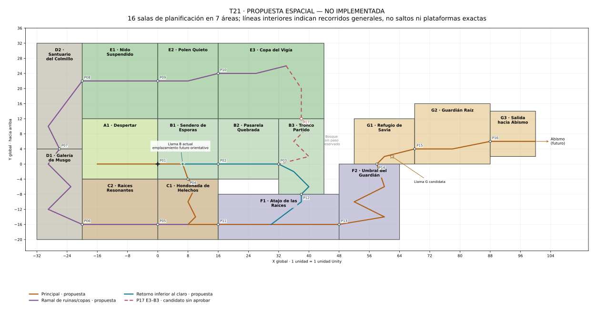
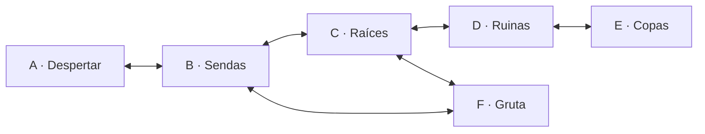
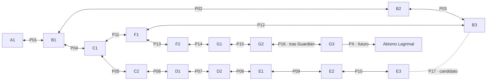

# Arboleda Verdescente — Plano espacial T21

**Estado actualizado en T25:** el usuario confirma T01–T24 aprobadas y duración adecuada de B2 para su función. T25 añade B3/P03, pendiente de aprobación manual. La planta T21 sigue como referencia provisional; sus tablas originales y SVG no son un inventario de escenas construidas. Ver §17 para T22, §18 para B1/B2 de T24 y **§19 para B3/P03 y la apertura oriental vigente de B2**. No se conecta B3 con F ni se construye G.

**Contexto histórico de T21:** inspección sobre `76510b6` (T20). El usuario confirmó entonces T01–T20 aprobadas, incluidas 8/8 pruebas funcionales y 6/6 de feedback de T20. T21 solo modificó documentación; en ese momento las seis escenas y sus seis enlaces bidireccionales permanecían iguales.

Este documento concreta la geografía que [Region1Plan](Region1Plan.md) dejaba abierta. Su SVG y tablas describen la **planta objetivo de T21**, no posiciones que existan íntegramente en Unity. Se conserva el alcance de 15–18 salas, objetivo 16; no se convierten las siete áreas en siete únicas habitaciones ni se construyen las 16 en T22.

## 1. Diagnóstico de las seis muestras actuales

Se leyeron los YAML guardados de A–F, sus overrides de `RoomPlayerRig`, colliders, entradas/salidas y RoomDefinition, y se contrastaron con configuradores, GDD y registros T16–T20. Ruta común de escenas: `Assets/_Project/Scenes/Arboleda/TechnicalCircuit/Arboleda_<ID>_<nombre>.unity`.

### 1.1 Dimensiones y recorrido medidos en los archivos

Las alturas siguientes son locales. El rectángulo de cámara incluye fondo y márgenes; no define un emplazamiento global ni equivale a la superficie caminable. Todas las salas tienen suelo continuo a 0, cámara ortográfica 5.5 y paredes laterales sólidas; las paredes alcanzan y=16 en A/B/C/F y 28 en D/E. Los triggers de paso interceptan al jugador antes de esas paredes: aún no representan huecos físicos de borde.

| Escena / área de muestra | Anchura del suelo | Límites de cámara X; Y | Suelos superiores y recorrido |
| --- | --- | --- | --- |
| A Claro del Despertar | 20 | 0..20; −4..12 | Raíz a 0.4, x=12..14.5. Inicio (4,0.58); Colmillo (8.2,0.55). |
| B Claro de las Sendas | 24 | 0..24; −4..12 | Escalones 1.5 / 3 / 4.6; acceso A a 3.6 / 5.3. Llama en (6.6,0). |
| C Raíces Profundas | 24 | 0..24; −4..17 | Terrazas 8 / 6 / 4 / 2; rama oriental a D por dos apoyos a 6. |
| D Ruinas del Colmillo | 22 | 0..22; −4..21 | Ascenso 1.8 / 3.6 / 5.4 / 7.2 / 9 / 10.8; mirador 7.2; dintel 2.8. |
| E Copas del Vigía | 32 | 0..32; −4..23 | Ruta 1.4 / 3.2 / 5.1 / 6.5 / 8.5 / 9.8 / 11.4; alternativa 2.5 / 4.5 / 6.6, recuperación 0.9. |
| F Gruta del Retorno | 24 | 0..24; −4..12 | Apoyos 0.8 / 2 / 3.8 y terraza oriental a 3.8. |

Para reproducir la inspección de plataformas, estos son sus intervalos X y alturas superiores, excluyendo suelo y paredes:

- A: Root Rise [12,14.5]@0.4.
- B: Step 1 [8,11]@1.5; Step 2 [13,16]@3; Upper [18,24]@4.6; Awakening Approach [5,7.5]@3.6; Awakening Landing [0,3.2]@5.3.
- C: Upper [0,7]@8; Terrace 6 [9,13]@6; Terrace 4 [4,8]@4; Terrace 2 [10,14]@2; Ruins Approach [15,18]@6; Ruins Gate [20,24]@6.
- D: Entry Roof [0,1.9]@2.8; Base Step [7,11]@1.8; West Landing [2,6]@3.6; Broken Crossing [7,12]@5.4; East Rest [14,20]@7.2; Inner Ledge [8,12]@9; Upper Chamber [14,21.5]@10.8; West Lookout [1.5,4.5]@7.2.
- E: Fork Bough [7,15.5]@1.4; Main West Bough [2.8,7.5]@3.2; Main Crossing [9,14]@5.1; Main Return [3,7]@6.5; Crown Junction [9.5,17]@8.5; Watch Approach [19,24]@9.8; Watch Lookout [25.5,32]@11.4; Side Sprig [18,22.5]@2.5; Side Outer Bough [25,30]@4.5; Side Inner Bough [19,23.5]@6.6; Lower Catch [22.8,26]@0.9.
- F: Low [6,8.5]@0.8; Middle [10,13]@2; High [15,18]@3.8; East [19,24]@3.8.

### 1.2 Puertos actuales, no propuestos

T = centro real del trigger; h = suelo de acceso, T.y−1. Las llegadas son centros del jugador, no puntos del borde. O/E indican oeste/este y →/← la orientación al aparecer. Los triggers actuales miden 1.2×2.

| Salida existente | T; h; lado de salida | Destino / entrada real | Aparición y orientación |
| --- | --- | --- | --- |
| A-to-B | (18.8,1); 0; E | B / from-A, O | (2.65,5.88) → |
| B-to-A | (1.2,6.3); 5.3; O | A / from-B, E | (16.5,0.58) ← |
| B-to-C | (1.2,1); 0; O | C / from-B, O | (4,8.58) → |
| C-to-B | (1.2,9); 8; O | B / from-C, O | (4,0.58) → |
| C-to-D | (22.8,7); 6; E | D / from-C, O | (4,0.58) → |
| D-to-C | (1.2,1); 0; O | C / from-D, E | (20.5,6.58) ← |
| D-to-E | (20,11.8); 10.8; E, interior del recinto | E / from-D, O | (4,0.58) → |
| E-to-D | (1.2,1); 0; O | D / from-E, E | (16.5,11.38) ← |
| C-to-F | (22.8,1); 0; E | F / from-C, O | (4,0.58) → |
| F-to-C | (1.2,1); 0; O | C / from-F, E | (20,0.58) ← |
| F-to-B | (22.8,4.8); 3.8; E | B / from-F, E | (19.5,5.18) ← |
| B-to-F | (22.8,5.6); 4.6; E | F / from-B, E | (20,4.38) ← |

Los inicios directos son (4,0.58) en A/B/D/E/F y (4,8.58) en C. Solo una sesión iniciada en A comienza desarmada y recupera en A sin checkpoint; las otras recuperan en B. La posesión, vida y desbloqueos se transfieren correctamente: **el problema diagnosticado es geográfico, no un fallo de persistencia**.

### 1.3 Contradicciones concretas

1. **Oeste↔oeste en B–C y este↔este en F–B.** No pueden ser bordes enfrentados de rectángulos vecinos mediante una simple traslación. Un túnel en U podría explicarlo, pero ese recorrido no está construido ni representado; no debe suponerse invisible.
2. **El circuito inferior no cierra en altura.** Si Y_B, Y_C y Y_F fueran offsets globales constantes y se alinearan los suelos de sus puertas: B–C exige Y_C=Y_B−8; C–F exige Y_F=Y_C; F–B exige Y_F+3.8=Y_B+4.6, es decir Y_F=Y_B+0.8. Hay **8.8 unidades de incompatibilidad**. La suma de offsets B→C→F→B es −8.8, no 0. Son cotas de suelo, no diferencias de los spawns interiores.
3. **A–B no es imposible por sí sola:** derecha↔izquierda es correcto y el desnivel local 5.3 se podría absorber colocando A más alta. Sin embargo, el acceso elevado fue una solución técnica al oeste ocupado por C, no una decisión geográfica definitiva del comienzo.
4. **C–D y D–E sí pueden alinearse individualmente.** D puede empezar 6 unidades por encima del suelo C y E 10.8 por encima del suelo D. D ya construye ese ascenso. Lo que falta es fijar su huella respecto a A/B y el resto de la región; entrar en y local 0 de E no significa que E esté al nivel del bosque.
5. **Cada escena repite un recinto independiente con suelo continuo.** No hay aún pozos abiertos entre B/C o F/B, bordes compartidos ni datos globales. Un marco de paso funcional no demuestra una ruta física. Los límites de cámara tampoco se pueden pegar como si fueran habitaciones definitivas.

## 2. Qué se conserva y qué queda en propuesta

**Confirmado:** despertar y Colmillo en A; identidad de las áreas; Llamas, combate/movimiento, exploración sin exigir dash/doble salto; jefe Guardián Raíz y salida a Abismo según GDD; sistemas T17–T20 y sus pruebas aprobadas. El objetivo de 15–18 salas sigue vigente. No se cambia historia, estadísticas, adquisición de habilidades ni funcionamiento de los checkpoints.

**Muestras técnicas:** tamaño, muros rectangulares, terrazas, puertos y posiciones locales actuales. Sus pruebas demuestran funcionalidad, no la aprobación de una planta global. Sus aprendizajes se reutilizan; no se promete que baste trasladar seis bloques sin rediseñar geometría.

**Propuesta T21:** los 16 recintos, offsets y puertos de las secciones siguientes, el reparto físico del tronco, posiciones de contenidos futuros y el posible retorno superior. Ninguno está implementado por este documento.

## 3. Principios y convención de coordenadas

- X crece a la derecha y Y hacia arriba; 1 unidad de plano equivale a 1 unidad Unity. El origen regional **(0,0)** es el umbral occidental de B1 a la altura del sendero desde A.
- Cada sala tiene un ancla **O**, que representa dónde cae su (0,0) local en la región. **G=O+L** y **L=G−O**. No se aplican giros, espejos ni cambios de escala entre salas para corregir puertas.
- Para simplificar la tabla, se usa una envolvente local de planificación **Rect(0,−4,W,H)**. Por tanto, si el rectángulo global comienza en (xmin,ymin), **O=(xmin,ymin+4)**. El ancla no es necesariamente la esquina inferior ni el primer suelo. La convención conserva el suelo 0 de A/B1 y admite coordenadas locales negativas, como las escenas actuales.
- El rectángulo es la envolvente física del diseño, con margen inferior: no exige rellenarlo de plataformas ni define la cámara. El suelo, raíces y ruinas dentro pueden ser orgánicos. Las cámaras y el decorado pueden ocupar más espacio sin convertirlo en otra ruta ni solapar los volúmenes físicos de las salas.
- Un **puerto P** es una referencia del borde compartido. En un paso horizontal su Y indica la cota del suelo. En uno vertical indica el plano por el que se cruza entre las dos envolventes. P no es el centro del trigger ni un spawn.
- Puertas horizontales: E de la sala izquierda ↔ O de la derecha, con la misma cota global. Puertas verticales: N de la inferior ↔ S de la superior. Un gran cambio de altura se recorre dentro de salas y se ve en el plano; no se esconde en una carga.
- Referencia de diseño: salto normal medido ≈2.74; proponer escalones de 1.5–2.1, apoyos amplios y descansos, sin usar el máximo como requisito. El plano no prueba su ejecución física. Ni saltos ni dash se alargan para adaptarse a él.

## 4. Distribución recomendada y presupuesto

Las áreas A–G son geografía; los IDs A1–G3 son **salas de planificación**, no nombres de escenas nuevas ni cambios de RoomId. Se mantienen los 16 nombres de trabajo de T16, con Galería de Musgo debajo del Santuario por su función de ascenso. «Salida hacia Abismo» identifica la función de la antigua «Salida del Velo» sin introducir un evento del Velo en región 1.

| Sala y nombre de trabajo | Rect global (xmin,ymin; W×H) | Ancla O | Vecinos por puertos base |
| --- | --- | --- | --- |
| A1 · Claro del Despertar | (−20,−4; 20×16) | (−20,0) | B1 |
| B1 · Sendero de Esporas | (0,−4; 16×16) | (0,0) | A1, B2, C1 |
| B2 · Pasarela Quebrada | (16,−4; 16×16) | (16,0) | B1, B3 |
| B3 · Tronco Partido | (32,−8; 12×20) | (32,−4) | B2, F1; E3 solo candidato |
| C1 · Hondonada de Helechos | (0,−20; 16×16) | (0,−16) | B1, C2, F1 |
| C2 · Raíces Resonantes | (−20,−20; 20×16) | (−20,−16) | C1, D1 |
| D1 · Galería de Musgo | (−32,−20; 12×24) | (−32,−16) | C2, D2 |
| D2 · Santuario del Colmillo | (−32,4; 12×28) | (−32,8) | D1, E1 |
| E1 · Nido Suspendido | (−20,12; 20×20) | (−20,16) | D2, E2 |
| E2 · Cámara del Polen Quieto | (0,12; 16×20) | (0,16) | E1, E3 |
| E3 · Copa del Vigía | (16,12; 28×20) | (16,16) | E2; B3 solo candidato |
| F1 · Atajo de las Raíces | (16,−20; 32×12) | (16,−16) | C1, B3, F2 |
| F2 · Umbral del Guardián | (48,−20; 16×20) | (48,−16) | F1, G1 |
| G1 · Refugio de Savia | (52,0; 16×12) | (52,4) | F2, G2 |
| G2 · Cámara del Guardián Raíz | (68,0; 20×16) | (68,4) | G1, G3 tras el jefe |
| G3 · Salida hacia Abismo | (88,2; 12×12) | (88,6) | G2; salida regional futura |

Reparto por área: **A: 1; B: 3; C: 2; D: 2; E: 3; F: 2; G: 3 = 16 salas**. La huella máxima es X=−32..100, Y=−20..32. Las seis escenas actuales son muestras de sus áreas; no se asigna automáticamente una de ellas a cada subzona ni se da por construida ninguna subdivisión.

## 5. Mapa espacial de bloques

[Abrir SVG ampliable](Region1SpatialMap.svg). Bloques y ejes están a escala; sus líneas interiores expresan recorridos generales, **no plataformas ni saltos individuales**. Naranja: progreso principal; violeta: excursión de ruinas/copas; azul: retorno inferior; discontinuo rosa: P17, candidato sin aprobar. Todos los bloques muestran la propuesta futura, no el mapa actual.

La forma deja A bajo las copas, C bajo A/B, D ascendiendo por el borde occidental, F bajo el lado oriental y G encima del extremo de la gruta. El espacio entre B3 y G1 es bosque de fondo reservado, **sin paso B–G**. No se promete un salto sobre ese vacío ni se le asigna una habilidad.

## 6. Puertos propuestos y comprobación de correspondencia

E/O/N/S = este/oeste/norte/sur. Cada fila es bidireccional salvo la salida externa PX. Todos los pares comparten el **mismo punto global**; las dos coordenadas locales difieren porque sus anclas son distintas. Los IDs Pxx no se añaden al juego en T21.

| Puerto / estado | Sala · borde · L | Sala · borde · L | Punto global P |
| --- | --- | --- | --- |
| P01 · base propuesta | A1 E (20,0) | B1 O (0,0) | (0,0) |
| P02 · base propuesta | B1 E (16,0) | B2 O (0,0) | (16,0) |
| P03 · base propuesta | B2 E (16,0) | B3 O (0,4) | (32,0) |
| P04 · base propuesta | B1 S (8,−4) | C1 N (8,12) | (8,−4) |
| P05 · base propuesta | C1 O (0,0) | C2 E (20,0) | (0,−16) |
| P06 · base propuesta | C2 O (0,0) | D1 E (12,0) | (−20,−16) |
| P07 · base propuesta | D1 N (6,20) | D2 S (6,−4) | (−26,4) |
| P08 · base propuesta | D2 E (12,14) | E1 O (0,6) | (−20,22) |
| P09 · base propuesta | E1 E (20,6) | E2 O (0,6) | (0,22) |
| P10 · base propuesta | E2 E (16,8) | E3 O (0,8) | (16,24) |
| P11 · base propuesta | C1 E (16,0) | F1 O (0,0) | (16,−16) |
| P12 · base propuesta | F1 N (22,8) | B3 S (6,−4) | (38,−8) |
| P13 · base propuesta | F1 E (32,0) | F2 O (0,0) | (48,−16) |
| P14 · base propuesta | F2 N (10,16) | G1 S (6,−4) | (58,0) |
| P15 · base propuesta | G1 E (16,0) | G2 O (0,0) | (68,4) |
| P16 · después del jefe | G2 E (20,2) | G3 O (0,0) | (88,6) |
| P17 · **candidato sin aprobar** | E3 S (22,−4) | B3 N (6,16) | (38,12) |
| PX · salida futura | G3 E (12,0) | Abismo: sala aún sin diseñar | (100,6) |

Ejemplo horizontal: P08 sale de D2 a G=(−32,8)+(12,14)=(−20,22), y entra en E1 a G=(−20,16)+(0,6)=(−20,22). Las ruinas suben físicamente antes de entrar en las copas: no se interpreta el suelo local de E como nivel del bosque.

### 6.1 Spawns, triggers y apoyos a ambos lados

- Mantener separados P, trigger y RoomEntrance. Un trigger horizontal puede estar algo dentro del borde, a una unidad sobre el suelo como ahora; el spawn debe estar más adentro, sobre una superficie segura, orientado al interior. Dimensionar esos márgenes con el collider real, no solo con el punto de entrada.
- En vertical, reservar una abertura y repisas laterales, sin suelo/techo sólido atravesando el paso. La repisa alta puede estar a Y=P.y; la baja a P.y−2, de modo que el retorno tenga un salto normal de 2. El resto del descenso/ascenso se resuelve con apoyos internos. No se cae desde el techo de una sala hasta su fondo para volver mediante un salto enorme.
- Ejemplo P04: en B1, repisa junto al hueco a global Y=−4; en C1, repisa a −6. Centros de aparición orientativos en G=(10,−3.42) y G=(10,−5.42), respectivamente: dos unidades fuera del eje X=8 y 0.58 sobre sus suelos. Convertir a local restando O. No son coordenadas ya comprobadas con física.
- Aplicar el mismo criterio a P07/P12/P14 y, solo si se aprueba, P17. Abrir el paso no añade escalera, ascensor, wall-jump ni interacción nueva: movimiento, gravedad y salto existentes bastan para el graybox previsto.
- El spawn completo debe quedar fuera de todos los triggers, con apoyo y despeje, y no arrastrar al jugador hacia otra salida. Reutilizar SpawnSafety2D y la protección actual de 0.25 s como complemento, nunca como sustituto de separación física. Reprobar ambas direcciones y caídas después de construir.

## 7. Mapas de conexiones y estados

### Actual, implementado y sin cambios en T21

### Propuesta de salas; línea discontinua = candidato no aprobado

Las líneas continuas siguientes **también son futuras**. La coincidencia de las relaciones entre áreas con el grafo actual no significa que estos recintos o puertos ya existan.

La base tiene 16 salas conectadas y 16 enlaces internos: **un circuito independiente**, el inferior. Con P17 serían 17 enlaces y **dos circuitos independientes**. El objetivo regional de al menos dos circuitos entre áreas del GDD no se declara satisfecho sin aprobar/probar el retorno superior u otra alternativa útil. No se añade un segundo paso arbitrario D–E solo para aumentar ese número.

## 8. Evaluación de cada conexión y de los atajos anteriores

| Relación | Decisión recomendada para una tarea posterior | Salida / entrada y recorrido físico | ¿Mantener exactamente como está? |
| --- | --- | --- | --- |
| A ↔ B | Conservar relación y comienzo claro; simplificar cotas | A1 E → B1 O por P01, suelo global 0. B1 devuelve hacia A por el mismo sendero. | No el acceso alto actual. A admite mucho reaprovechamiento; B debe liberar el oeste a nivel del sendero al mover C abajo. |
| B ↔ C | Conservar descenso, sustituir emplazamiento oeste↔oeste | B1 S → C1 N por P04, con repisas −4/−6 y terrazas hacia −16. | No. Requiere abertura y nuevo recorrido vertical visible. |
| C ↔ D | Conservar excursión, cambiarla al oeste | C1 → C2 O → D1 E por P05/P06; ascenso D1→D2 por P07. Ruinas bordean el oeste de A sin ocupar su interior. | No el puerto oriental actual de C. Cambian reparto y geometría, no su función de descubrimiento. |
| D ↔ E | Conservar relación con ascenso explícito | D1 sube de −16 a una repisa a 2; D2 recibe a 4 y asciende a 22. D2 E → E1 O por P08 a igual cota. | Reutilizar idea y márgenes de D, no copiar su salida local a un origen arbitrario. El cambio de altura se construye en dos salas. |
| C ↔ F | Conservar travesía inferior, orientación ya coherente | C1 E → F1 O por P11 a suelo global −16; F continúa bajo el claro. | Es el enlace más reaprovechable, pero las cotas/anchura finales se adaptan a los nuevos recintos. |
| F ↔ B | Conservar el retorno, sustituir la puerta este↔este | Desde F1, subir por raíces hasta P12 N; aparecer en B3 por S y subir dentro del tronco hasta P03 O → B2 E, suelo global 0. | No. El desnivel de 16 se ve y recorre entre F1 y B3; no se oculta al cargar. |
| E ↔ B, inexistente | **Reservar P17 como candidato recomendado**, condicionado al graybox | E3 baja de las copas hacia la base en Y=12; entra por N de B3, desciende el mismo tronco y sale hacia B2. Es un retorno corto tras la excursión D/E. | No construir ni aprobar automáticamente. Medir su utilidad frente a desandar ruinas. |
| F ↔ G, inexistente | Proponer avance regional | F1 E → F2 O por P13; F2 asciende desde −16 hasta repisa −2, cruza P14 y entra en G1 por S con primer apoyo a 0. G1 lleva a la arena y salida. | No existe; requiere geometría y contenido futuros autorizados aparte. |

**Descartados para esta planta, sin borrar nada del juego actual:** los emplazamientos oeste↔oeste B–C y este↔este F–B sin túnel representado. Se conservan las relaciones útiles, sustituyendo sus formas físicas.

Los candidatos T16 tampoco son decisiones confirmadas: P1 D↔F por dash se descarta en esta planta porque las áreas no comparten borde y una distancia de varias decenas de unidades no se justifica con dash 3.2. P2 F↔E por doble salto se sustituye como idea de circulación por el tronco F1–B3–E3, **solo si se aprueba P17**, con salto normal; no se exige saltar 20 unidades de altura. P3, otra pasarela directa B–E, se aplaza para no duplicar P17 antes de medirlo. No se fija adquisición alguna.

## 9. Recorridos y sentido de los retornos

**Inicio y eje candidato:** A1 (Colmillo) → B1 (Llama/orientación) → C1 (descenso y primera elección inferior) → F1 (gruta bajo el claro) → F2 (ascenso oriental) → G1 (refugio) → G2 (Guardián) → G3 (salida). P16 representa el requisito narrativo de superar al jefe; su implementación no se decide aquí. La salida a Abismo no tiene aún una sala receptora diseñada.

**Excursión opcional:** desde C1, ir al oeste por C2, subir por las ruinas D1/D2 y entrar en E1; recorrer E2 hasta el mirador E3. Se vuelve por el mismo camino si P17 no se aprueba. Si se aprueba, se baja por el tronco B3 y se reconoce el claro desde su lado oriental, sin rehacer toda la excursión.

**Retorno inferior siempre accesible:** F1 → P12 → B3 → B2 → B1. En F1 se sube desde suelo −16 hasta la repisa −10, y al cruzar se llega a la base del tronco −8. Dentro de B3 se asciende hasta el suelo 0 del claro. Cada tramo necesita escalones con descansos, no un salto de 8 o 16. El tronco debe verse desde las raíces y desde B2. Este retorno permite descansar y volver después hacia G; no obliga a completar el circuito para avanzar.

**Libertad de ruta:** B1 → B2 → B3 → F1 → F2 → G sigue siendo posible sin pasar por C. No se introduce una puerta o llave para forzar el orden. Se recomienda que C ofrezca descubrimientos/encuentros y que la vuelta revele la geografía, en lugar de castigar el conocimiento del camino corto.

**Segundo circuito condicionado:** B1–C1–C2–D1–D2–E1–E2–E3–B3–B2–B1, solo con P17. La reserva aprovecha un borde real de las copas sobre el mismo tronco del retorno inferior; no es un enlace E–B colocado donde sobre un marco.

## 10. Salas intermedias y escala razonable

No se agregan áreas H/I ni una cadena nueva de túneles. Los conectores se absorben en el presupuesto existente:

- **C2** extiende raíces bajo A y lleva a los cimientos occidentales; permite situar D sin atravesar B ni solapar el claro de inicio.
- **D1 y D2** dividen el ascenso de ruinas en dos vuelos con descanso y destino reconocible. Cada uno cubre aproximadamente 18 de subida, alrededor de nueve o diez escalones normales con pausas; es una estimación geométrica, no física probada ni un tiempo de recorrido. Si resulta repetitivo, reducir altura/escala antes de añadir otra habilidad.
- **B3** es el ascenso físico de retorno que falta, no un pasillo adicional sin función. La parte superior hacia P17 se reserva; no se llena de plataformas hasta decidir ese enlace.
- **F2** enlaza gruta y umbral mediante un ascenso con descanso intermedio. E1/E2 separan la llegada por ruinas y la travesía de copas del destino E3. G conserva refugio, arena y salida como funciones distintas.

No todas las reservas deben construirse de una vez. Primero se valida un sector con A1/B1/B2/B3/C1/F1; luego se justifica la ampliación. La tabla de 16 es una hipótesis de producción, no una obligación de rellenar cada rectángulo.

## 11. Candidatos para contenido futuro

Son emplazamientos de función por revisar, no objetos añadidos ni cantidades de enemigos aprobadas. Todas las posiciones son globales y caben en las envolventes propuestas.

| Lugar candidato | Función propuesta y límites |
| --- | --- |
| A1, alrededor de (−12,0) | Colmillo cercano al despertar, como está confirmado. Inicio sin enemigos/peligros; no convertir la recogida en un tutorial de combate obligatorio. |
| B1, (6.6,0) | Conservar la función de Llama central y referencia visual. Punto orientativo que permite mantener el suelo 0 del B actual si se reutiliza como B1; revisar apoyo/respawn al migrar. |
| B2, (24,0), o C1, (10,−14) | Primer encuentro según ruta elegida, en suelo amplio, fuera de triggers y del descanso/recepción de una caída. Elegir configuración tras probar distancias de detección actuales; no ajustar estadísticas para encajarlo. |
| F1, cerca de (28,−16) | Combate de preparación tras pausa, sin ocupar el pie del ascenso de retorno ni impedir reconocerlo. La elección entre volver a B o seguir hacia G debe poder observarse antes del encuentro. |
| D2, (−26,20) | Candidato a memoria opcional ya prevista del maestro, en una cámara tranquila. Sin recompensa obligatoria ni nuevo lore; puede visitarse y abandonarse sin bloquear progreso. |
| E3, cerca de (30,26) | Mirador como destino ambiental: ver bosque, ruinas y tronco. No colocar recompensa, habilidad o combate por defecto solo para justificar la altura. |
| C2 y F2, p. ej. (−10,−12) y (60,−6) | Reservas laterales para descubrimientos/secretos posteriores, con recuperación hacia la ruta base. Su acceso se diseña después; no se declara que necesiten dash o doble salto. |
| D2 alto / E2 alto | Posibles repisas opcionales para revisitas con habilidades, si su adquisición y utilidad se aprueban. No fijar aquí dónde se consiguen ni hacer depender de ellas el camino inicial. |
| G1, cerca de (62,2) | Llama previa al jefe como función de descanso del GDD; candidato de ubicación, no checkpoint implementado. Retorno breve y despejado hacia G2, sin encuentro obligatorio entre descanso y arena. |
| G2/G3 | Guardián y posterior salida regional según GDD. Diseño del combate, activación del paso y sala receptora de Abismo en tareas propias. |

No se propone ahora otra Llama en F. Medir repetición tras morir y orientación antes de aumentar su número. La escenografía turquesa sigue reservada a Llamas; no se restauran los cristales decorativos retirados. Espacios de secretos y habilidades no son puertas visibles que prometan una acción inexistente.

## 12. Compatibilidad con la arquitectura actual

RoomDefinition guarda RoomId, ScenePath, entrada inicial, sala de recuperación y política de arma; **no tiene posición global ni tamaño de mapa**. RoomEntrance guarda ID/orientación y comprueba aparición; RoomExit usa un trigger para pedir carga. RoomSession carga Single, conserva progreso y coloca el cuerpo en un RoomEntrance local. No deduce dirección, distancia ni vecindad global, y resetea estados/velocidad al llegar.

La convención G=O+L puede mantenerse primero en esta documentación. Las escenas pueden seguir trabajando cerca de su origen local; **no se deben trasladar físicamente sus rigs al origen global** para conseguir un mapa. Si posteriormente se autoriza un mapa/editor de región, una extensión mínima de datos de sala (ancla y rectángulo local) bastaría para representarlos. No se necesita carga aditiva ni reescribir RoomSession para validar la geografía.

Los triggers 2D permiten orientar futuros pasos verticales, y RoomEntrance puede aparecer en una repisa segura mirando hacia el interior. Construir la abertura y sus apoyos requerirá adaptar geometría y pruebas, no fingir una transición vertical con dos paredes cerradas. El plano no elimina por sí solo el corte de cámara o el reinicio de velocidad propios de las transiciones técnicas actuales.

La división de una escena B en B1/B2/B3 exige decidir assets/IDs y conservar o migrar el ID de la Llama y su escena. Los IDs de esta propuesta no deben renombrar automáticamente los existentes. Revalidar CheckpointLocation y entradas con una sesión nueva después de cualquier migración geométrica; no se introduce guardado permanente.

## 13. Riesgos y contradicciones pendientes

| Riesgo | Tratamiento antes de construir más contenido |
| --- | --- |
| Dos circuitos regionales del GDD frente a E–B sin aprobar | La base solo cierra uno. P17 es una recomendación condicionada con geografía definida; si se rechaza, revisar una alternativa útil con el usuario, sin inventar una segunda puerta solo por el conteo. GDD no se modifica en T21. |
| Cámaras más anchas que varias salas | A 5.5 y 16:9, la vista tiene ≈19.56 de anchura; salas propuestas de 12/16 no la llenan. Probar paredes/fondos laterales y un rectángulo visual mayor sin abrir rutas fuera del mapa. Si no funciona, ensanchar envolventes y recalcular vecinos/puertos. No cambiar la cámara global para dar la planta por validada. |
| Ascensos D/F extensos | Probar descanso, variación de dirección y tiempo humano. Los segmentos inclinados del SVG no son saltos gigantes; desarrollar apoyos intermedios de ≤2.1 con margen y caída recuperable. Reducir desnivel si cansa. |
| Transformar muestras en producción | No es una operación de seis offsets: hay aperturas, plataformas y divisiones de escenas que crear/reubicar después de aprobar. Conservar funcionalidades y referencias mientras se migra cada sector. |
| B→F permite omitir C | Libertad deliberada; comprobar valor de descubrimientos/encuentros de C. No resolverlo automáticamente mediante cerraduras o adquisición obligatoria. |
| Sala G y regla posterior al jefe | No existen todavía. El puerto reservado no implementa una barrera, un boss ni una transición regional. Validar alcance y tiempos antes de comprometer su producción. |
| Mapa bonito pero nivel vacío | Los contenidos de la sección 11 son candidatos. Evaluar objetivos, pausas y descubrimientos en pruebas humanas; un grafo conectado no prueba interés ni diversión. |

## 14. Orden recomendado de adaptación, después de aprobar

1. Aprobar o ajustar envolventes, puertos y función de los retornos. Resolver si P17 solo queda reservado o se autoriza su futuro graybox. No ejecutar configuradores antiguos para regenerar el prototipo.
2. Definir en una tarea acotada los IDs/assets que representan las primeras salas, manteniendo A/Colmillo y checkpoint B. Revisar validadores con sus referencias espaciales nuevas, sin borrar las regresiones anteriores.
3. Adaptar primero **A1–B1–B2–B3–C1–F1**. Cerrar el circuito inferior con P04/P12 y aberturas reales; comprobar ambos sentidos, vida/arma/desbloqueos, spawns y muerte/R. Confirmar con el usuario que reconoce B desde debajo y no percibe un teletransporte.
4. Extender C2–D1–D2 y probar subida/descenso hasta la cota 22. Añadir E1–E2–E3 en otro bloque, con vistas al claro y recuperación, sin requerir habilidades. No añadir una puerta funcional a una sala que aún no existe.
5. Si se autoriza P17, validar descenso/ascenso por el mismo tronco B3 y medir el ahorro de regreso. Decidir conservarlo, recolocarlo o descartarlo antes de producir arte o encuentros de las copas.
6. Construir F2–G1 y reservar G2/G3 con alcance separado de la implementación del jefe/salida. Validar descansos y recuperación antes de situar la Llama previa al jefe o fijar su pose.
7. Situar encuentros y contenidos aprobados con los sistemas existentes; evaluar ritmo y repetición de recorridos. Solo después estudiar secretos/atajos por habilidades. Revalidar el conjunto y los prototipos técnicos antes de cerrar geografía.

## 15. Validaciones documentales realizadas y límites

- Inventario de las seis escenas guardadas, 12 salidas dirigidas, llegadas, plataformas y overrides de cámara; no se modificó ninguno de esos archivos.
- 16 rectángulos sin solapes de área, puertos dentro del tramo compartido (no esquinas), bordes opuestos y 17 parejas locales/globales coincidentes. Todos los recintos son alcanzables desde A1 sin P17; el grafo tiene un ciclo independiente de base y dos con P17. PX se excluye del conteo interno porque su sala de destino no está diseñada.
- SVG y tablas contrastados con la misma especificación; se inspeccionó una representación renderizada del SVG. Se distinguieron topología actual, geografía propuesta, reserva y emplazamientos descartados. Las rutas generales permanecen dentro de las envolventes propuestas.
- Se comprueba por hashes que T21 no cambia archivos de producto, GDD, escenas, código o Build Settings. No se ejecuta Unity ni compilación/pruebas de combate por una entrega exclusivamente documental. Las pruebas T20 aprobadas por el usuario no se presentan como pruebas nuevas de este mapa.

No están probados saltos, apoyos, cámara, orientación o duración humana de esta geometría futura. No hay salas nuevas en el juego. La medición manual exacta de los 0.8 s de i-frames sigue pendiente y fuera de T21.

## 16. Decisiones planteadas para revisión en T21

1. ¿Aprobar esta distribución de 16 salas como objetivo de trabajo, con ruinas rodeando el oeste del claro y copas por encima, o reducir/redistribuir sus alturas antes del primer graybox?
2. ¿Mantener como eje candidato A–B–C–F–G y el camino corto B–F libre, con D/E opcionales, en vez de forzar un orden mediante puertas?
3. ¿Reservar P17 E3–B3 como retorno recomendado para probar después, o replantear ya el segundo circuito regional? El puerto alineado no constituye aprobación de la conexión.
4. ¿Aceptar el tronco B3 como recorrido físico del retorno F–B y priorizar la adaptación del circuito inferior antes de añadir contenido a G/copas?

Los candidatos de enemigos, secretos, descanso G y adquisiciones futuras necesitan sus propias decisiones; no se consideran aprobados al aceptar solo la planta. T21 termina en esta propuesta y espera revisión antes de modificar escenas.

## 17. Adaptación parcial T22 — A, B y C

La escena A existente sirve de muestra A1 sin cambios de asset: inicio `(4,0.58)`, Colmillo `(8.2,0.55)`, suelo 0, raíz baja y salida derecha `(18.8,1)`. B sigue siendo **una escena técnica** de 24 unidades: su zona occidental x=0..16 representa el arranque de B1; x=16..24 continúa provisionalmente hacia el este y **no equivale a construir B2**. C sigue siendo una escena de 24 unidades: x=0..16 representa el arranque de C1 y x=16..24 conserva la extensión técnica hacia D/F; **no equivale a construir C2 o F1**. No se crean RoomDefinitions, IDs ni escenas nuevas.

| Paso | Estado T22 en coordenadas locales | Relación con T21 |
| --- | --- | --- |
| P01, A↔B | Salida A `(18.8,1)` → llegada B `(3,0.58)`; salida B `(1.2,1)` → llegada A `(16.5,0.58)`. Suelos de ambos lados a 0. | Sendero horizontal A1 este ↔ B1 oeste, cota global 0. El trigger queda dentro de la pared lateral técnica, como en el sistema existente. |
| P04, B→C | B abre un pozo x=9..15, fondo a −4, salida `(11,−3)`; C recibe en `(13,10.58)` sobre una repisa a 10. | B1 sur ↔ C1 norte. Con O_B=`(0,0)` y O_C=`(0,−16)`, ambos triggers quedan en global `(11,−3)` y el plano de paso es global y=−4. |
| P04, C→B | C tiene paso superior x=7..15 y salida `(11,13)` sobre repisa a 12; B recibe en `(12.3,−3.42)` sobre el fondo del pozo a −4. | El retorno usa salto normal desde la terraza C de 8 a un apoyo de 10 y luego a la repisa de 12. El segundo tramo del retorno en B sube desde −4 mediante dos apoyos a −2 hasta suelo 0. |

El eje P04 se desplazó de x=8 en la propuesta a **x=11** en este graybox. En B, la Llama existente ocupa x=6.6 y el escalón existente `B Step 1` ocupa x=8..11 a altura 1.5; el pozo x=9..15 permite conservarlos y dejar un descenso practicable. El plano de paso y=−4 y la relación vertical B1/C1 sí se conservan. Las apariciones difieren de las orientativas de T21 porque se ubicaron sobre apoyos seguros y separadas de los triggers. El techo de C se construyó en dos tramos sólidos x=0..7 y x=15..24, dejando la abertura superior.

En B se retiraron únicamente los dos apoyos altos de la conexión provisional de T20 con A. Su suelo quedó en x=0..9 y x=15..24, con fondo del pozo x=9..15 y repisas x=9..10.5 y x=13..15 a −2. La cámara de B amplió su límite inferior local de −4 a −6 para incluir el pozo; mantiene x=0..24, límite superior 12 y tamaño ortográfico. En C permanecen las terrazas anteriores, y se añadieron apoyos x=6.5..9.5 y x=11.5..14.5 a 10, más la repisa x=9.5..12.5 a 12. Sus límites de cámara no cambiaron.

P01 y P04 ya expresan la dirección y altura del mapa T21 mediante geometría jugable, aunque RoomSession todavía carga escenas Single y reinicia velocidad al atravesar los triggers. Los pasos C↔D, C↔F y F↔B siguen siendo **enlaces técnicos** con sus posiciones anteriores. En particular F↔B continúa este↔este y no representa P12/B3. Tampoco se implementaron P02, P03, P05 ni las restantes subdivisiones o puertos del SVG. La extensión oriental actual de C se superpone a la zona reservada para F1 si se aplica literalmente el ancla de T21; deberá separarse al construir C1/F1. El dibujo a escala es una guía de destino, no una captura del graybox T22.

La siguiente adaptación deberá resolver la división B1/B2 y la extensión C1/F1, reubicar los enlaces técnicos sin perder vida, Colmillo ni checkpoint, y probar manualmente las vistas y la lectura del pozo. T22 no decide todavía la función de P17 ni modifica GDD, movimiento, combate o conexiones externas.

## 18. Adaptación T24 — B1↔B2 / P02

**Implementación para revisión manual, no aprobación de T24.** `Arboleda_B_ClaroSendas.unity` se reutiliza como B1, sin duplicarla ni renombrar su RoomId **B** o el checkpoint `B.memory-flame`. Se crea `Assets/_Project/Scenes/Arboleda/TechnicalCircuit/Arboleda_B2_PasarelaQuebrada.unity` y su RoomDefinition homónimo en `Data/World/Rooms`, RoomId **B2**, recuperación B. Es una séptima escena regional, no la construcción del área B completa. El nombre Pasarela Quebrada procede de la tabla T21; «sector central» describe su función.

### Dimensiones y correspondencia global

| Sala actual | Ancla global | Envolvente de planificación local/global | Límites de cámara locales |
| --- | --- | --- | --- |
| B1, escena técnica B adaptada | (0,0) | Local (0,−4;16×16); global X=0..16, Y=−4..12. El pozo conserva suelo a −4 y espesor sólido inferior. | X=0..16, Y=−6..12: incluye el pozo de T22. |
| B2, escena nueva | (16,0) | Local (0,−4;16×16); global X=16..32, Y=−4..12. | X=0..16, Y=−4..12. |

P02 sigue siendo **global (16,0)**: borde este B1 local (16,0) y oeste B2 local (0,0). No cambia la escala ni se desplaza B3. Los triggers están remetidos 0.4 respecto al borde y miden 0.8×2, con base a suelo 0; P no es su centro. El espesor exterior de los sólidos de frontera/fondo no representa una ruta en la sala vecina.

| Paso | Trigger local → centro global | Destino / aparición local y global | Orientación al llegar |
| --- | --- | --- | --- |
| B-to-B2 | B1 (15.6,1) → (15.6,1) | B2/from-B: local (2.2,0.58) → global (18.2,0.58) | Derecha |
| B2-to-B | B2 (0.4,1) → (16.4,1) | B/from-B2: local (14.6,0.58) → global (14.6,0.58) | Izquierda |

Las dos caras de los triggers alcanzan el mismo borde global X=16 y su base global es Y=0. Se abren los segmentos de pared correspondientes, con apoyo, despeje y separación entre spawn y trigger completos; no basta una carga correcta. CameraFollow2D mantiene código, tamaño 5.5 y suavizado. En 16:9 la vista es más ancha que la sala de 16, por lo que se centra horizontalmente y los fondos laterales cubren el margen sin abrir espacio jugable fuera del mapa.

### B1: cambio local necesario y acceso técnico a F

El pozo original terminaba en x=15 y la extensión llegaba a x=24. Al fijar el borde en 16 quedaba solo una unidad para recibir desde B2 y cruzar P02: insuficiente para separar con margen al jugador del trigger. Se conserva el eje P04 x=11, la llegada desde C (12.3,−3.42), el fondo Y=−4 y la repisa occidental. **Solo el lado oriental del pozo retrocede a x=14**, quedando fondo x=9..14, suelo oriental x=14..16 y repisa este x=12.9..14 a −2. El retorno desde C sigue usando dos saltos normales; se prueba además el regreso desde el lado este hacia el oeste del claro.

`B Step 1` y `B Step 2` permanecen; `B Upper` se recoloca a x=14..16, suelo 4.6. `B-to-F` conserva ID/destino y queda en (15.6,5.6); `from-F` conserva ID/orientación y aparece en (14.4,5.18). No cambia la escena F ni sus entradas/salidas. El acceso está por encima y separado de P02, con su abertura propia; se alcanza por los escalones. **Continúa siendo este↔este y geográficamente provisional**, sin túnel por B2 ni afirmación de P12. B3 y el sector inferior resolverán el retorno definitivo.

Se conservan los objetos originales de B y se ajustan transformaciones/bordes concretos; no se regenera la escena. Llama, P01, P04 y sus poses permanecen. P02 añade una entrada y una salida nuevas; los demás IDs siguen válidos.

### B2: recorridos y reservas de contenido

Intervalos X y cotas locales de los sólidos transitables:

- Suelo de recepción oeste [0,4.5]@0; raíz amplia [4.5,9.5]@1.2; escalón de descenso [9.5,10.8]@0; hondonada [9.5,12.5]@−1.2; suelo oriental [12.5,16]@0.
- Ruta secundaria: terraza de ramas [6.5,9.8]@3 y mirador [11.4,15]@4.8. Se sube desde la raíz con dos saltos de 1.8 y se regresa por las mismas repisas o bajando al suelo oriental y al camino inferior.

El recorrido principal presenta una subida moderada, plataforma de cinco unidades para un futuro encuentro, descenso y elección entre cruzar o bajar a la hondonada. El recorrido superior añade perspectiva y una vuelta por el suelo inferior. Las caídas previstas terminan en suelo/repisas seguros; la hondonada ofrece salidas de 1.2 a cada lado mediante el escalón o el suelo este. No hay daño ambiental, enemigos, recompensas, adquisiciones ni checkpoint nuevos.

La raíz central, p. ej. global (23,1.2), queda como reserva para contenido de Fase 2, no un encuentro aprobado. El mirador puede alojar un descubrimiento futuro sin objeto ni indicación interactiva actual. La presentación usa bloques/ramas/musgo provisionales sin decoración turquesa.

El **futuro P03** conserva B2 local (16,0), global **(32,0)**, hacia B3. Ahora está cerrado por un límite sólido con raíz/vegetación: no hay marco, trigger, entrada o destino hacia B3. P17 E3↔B3 sigue sin aprobar.

Se conserva el ancho 16 previsto para dar prioridad a coherencia y variedad dentro del bloque. **B1+B2 abarcan ahora X global=0..32, frente a las 24 unidades de la escena B anterior**, sin invadir B3. B2 individual sigue siendo aproximadamente una vista horizontal y **no demuestra una duración humana suficiente**. Si la prueba encuentra el recorrido todavía corto, se propone revisar explícitamente la escala conjunta B2/B3 y sus puertos/vecinos en el plano antes de ampliar, no extender esta sala dentro de las reservas ajenas. No se aplicó esa ampliación global en T24.

Los resultados de compilación, rutas con física real, inicio directo, estado de sesión, regresiones y capturas se registran en DevelopmentLog bajo T24. Su aprobación requiere la prueba manual, especialmente ritmo, orientación, lectura de la bifurcación y cámara.

## 19. T25 — Tronco Partido / B3 y P03

**Implementada para revisión, pendiente de aprobación manual.** Se crea `Assets/_Project/Scenes/Arboleda/TechnicalCircuit/Arboleda_B3_TroncoPartido.unity`, con RoomDefinition homónimo en `Data/World/Rooms`, RoomId **B3**, entrada inicial `start` y recuperación B. Inicio directo técnico armado, habilidades bloqueadas y sin checkpoint; al viajar se conserva el estado real de la sesión. B1 mantiene RoomId B y su Llama; F no se modifica.

### Envolvente y correspondencia de P03

B3 conserva la planta T21: **12×20**, ancla **O=(32,−4)**, rectángulo local (0,−4;12×20) y global **X=32..44, Y=−8..12**. No se ajustó la escala ni se desplazaron vecinos. B2 permanece en X global 16..32/Y=−4..12. Comparten borde X=32; el suelo local 4 de B3 corresponde al suelo global 0 de B2. No es una subida oculta en la carga.

| Puerto / extremo | Punto local de borde/suelo | Ancla | Punto global |
| --- | --- | --- | --- |
| P03 · B2 este | (16,0) | (16,0) | **(32,0)** |
| P03 · B3 oeste | (0,4) | (32,−4) | **(32,0)** |

| Salida real | Trigger local → global | Llegada destino local → global | Orientación |
| --- | --- | --- | --- |
| B2-to-B3 | (15.6,1) → (31.6,1) | B3/from-B2 (2.2,4.58) → (34.2,0.58) | Derecha |
| B3-to-B2 | (0.4,5) → (32.4,1) | B2/from-B3 (13.8,0.58) → (29.8,0.58) | Izquierda |

Los triggers 0.8×2 están remetidos 0.4: sus caras y bases coinciden en global (32,0); los spawns están más adentro, con cuerpo completo fuera de triggers, apoyo y despeje. La protección de llegada existente complementa esa separación. B3 solo contiene esa salida funcional, `start` y `from-B2`; no hay entrada F ni E.

En B2 se elimina únicamente la raíz decorativa que cerraba el borde reservado (`Overgrown Eastern Root`), se divide su límite oriental en zócalo y tramo superior y se añaden entrada/salida P03. P02, cámara, terreno, mirador y reservas de contenido se conservan. Una caída por el extremo oriental del mirador puede desembocar en el paso real a B3; la prueba de recuperación interna B2 usa ahora el lado occidental del mirador para no cruzar accidentalmente P03. No se modifica el movimiento para evitar la transición.

### Recorrido interior, niveles y recuperación

Tronco ancho y hueco mediante corteza lateral, raíces y puntas fracturadas de fondo, sin colisión ornamental ni arte final. El suelo inferior cierra la sala; paredes y copa delimitan el volumen. La cámara local usa **X=0..12, Y=−6..16**: conserva tamaño 5.5 y comportamiento global, añadiendo dos unidades visuales bajo la envolvente para mostrar suelo y pies en la cuenca. El espesor exterior de límites/fondo no cuenta como ruta en otra sala.

| Apoyo | Intervalo X local | Suelo local / global | Función |
| --- | --- | --- | --- |
| B3 Entry Root | 0..3.6 | 4 / 0 | Llegada occidental y regreso inmediato. |
| B3 East Clearing | 7..12 | 4 / 0 | Descanso amplio y reserva de encuentro/parry. |
| B3 Root Floor Seal | 0..12 | −4 / −8 | Cuenca segura y reserva inferior P12 cerrada. |
| B3 Lower East Root | 7..10.2 | −2.2 / −6.2 | Primer apoyo desde el fondo. |
| B3 Lower West Root | 1.8..4.8 | −0.3 / −4.3 | Giro hacia el oeste y descanso. |
| B3 Inner Knot | 4.8..7 | 1.8 / −2.2 | Reconexión de la cuenca con el acceso. |
| B3 West Fork | 3.5..6.5 | 5.8 / 1.8 | Bifurcación principal del tronco. |
| B3 East Fork | 7.8..11.6 | 7.5 / 3.5 | Ascenso por el lado oriental. |
| B3 Crown West | 3.8..7 | 9.5 / 5.5 | Cambio de dirección y reconexión. |
| B3 Crown Rest | 7.6..11.6 | 11.3 / 7.3 | Destino alto y pausa. |
| B3 Split Pocket | 0.8..3 | 7.6 / 3.6 | Desvío occidental para descubrimiento futuro. |

**Principal:** llegada → bifurcación oeste → rama este → corona oeste → descanso alto, con cambios de dirección y subidas 1.8/1.7/2/1.8. El claro oriental ofrece una excursión al mismo nivel global del sendero antes o después del ascenso.

**Capa inferior:** desde el claro se desciende al nudo interior, raíz este y cuenca. Desde suelo −4 se regresa por raíces a −2.2, −0.3, 1.8 y entrada 4: saltos 1.8/1.9/2.1/2.2, todos normales. No se obliga a remontar ocho unidades con una habilidad futura. Las caídas previstas terminan en ese suelo o apoyos desde los que se puede regresar.

**Secundaria:** bifurcación oeste → bolsillo a 7.6 → corona oeste a 9.5; también permite bajar y regresar por la bifurcación. Reconecta con el ascenso principal y no exige una recompensa o un desbloqueo. Reservas de Fase 2: claro oriental, p. ej. global (41.5,0), para encuentro terrestre/práctica de parry; bolsillo global aproximado (34,3.6) para descubrimiento opcional. No se añade contenido, dificultad de combate ni narrativa.

### Preparación inferior y compatibilidad

**P12 permanece reservado, no implementado:** B3 sur local **(6,−4)** + ancla (32,−4) = global **(38,−8)**. Coincide con F1 norte previsto local (22,8) + ancla (16,−16). La cuenca y sus raíces preparan la subida desde esa cota; el suelo sigue sólido, sin hueco falso, marco, trigger, RoomEntrance o interacción hacia F. Apertura, repisas y poses definitivas se diseñarán al separar C1/F1 y construir su salida superior segura.

La escena técnica F existente no es F1 terminado ni posee un acceso superior compatible. **F↔B1 sigue operativo y geográficamente incorrecto**, con sus IDs/poses de T24 intactos; no se traslada a B3 ni se duplica. Las tareas futuras de sector inferior/P12 deberán ofrecer el reemplazo funcional antes de retirarlo. T25 no cierra el circuito inferior geográfico.

P17 superior B3 local (6,16), global (38,12), continúa como candidato sin aprobar. La copa permanece cerrada, sin puerta ni referencia a E. G y sala 17 del jefe siguen pendientes, sin relación con la numeración de puertos.

Las pruebas, limitaciones y guía manual T25 figuran en DevelopmentLog. El usuario confirmó en T25 que B2 tiene duración adecuada; no se igualan artificialmente las duraciones de ambas salas ni se amplía la región para alargar B3.
